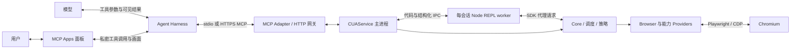
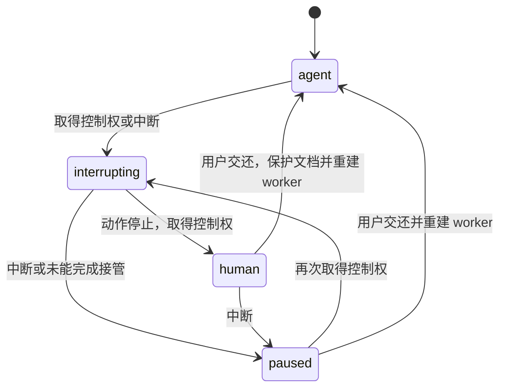
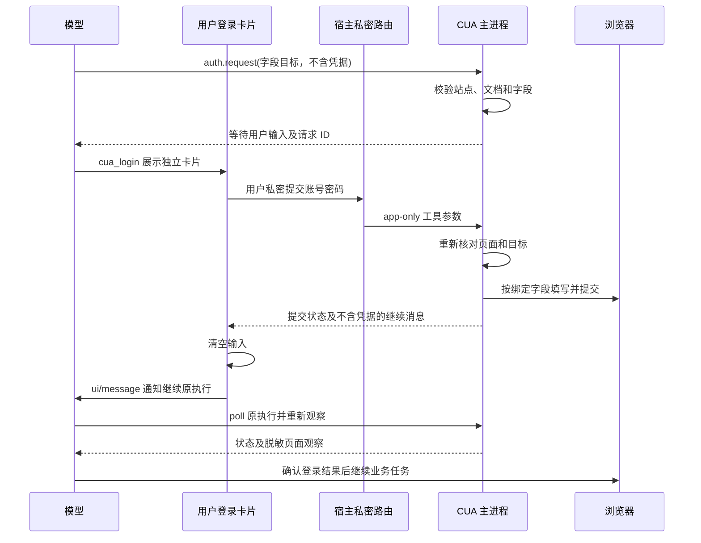

# Open CUA 架构与决策

更新：2026-10-19。本文说明现行实现的关键约束和取舍；接入步骤见 [Agent Harness 接入 CUA文档](harness-integration.md)，验证范围见 [最终工程计划](plan-v0.7.md)。

## 调用和进程边界



主进程持有浏览器连接、凭据、截图字节和资源归属；worker 持有代码状态、SDK 代理及不透明句柄。worker 重建不关闭浏览器。沙箱部署时，MCP、Service、worker 和浏览器均在沙箱，外部 harness 通过 HTTPS 转发访问 `/mcp`。

SDK 本身不包含模型调用、规划、视觉识别或自动验证码分类。模型可基于 AX/DOM 生成定位和动作，也可请求截图；截图是否送入视觉模型由 harness 决定。开发 Preview 的固定脚本不代表真实模型推理。

执行历史默认由 Service 写入独立的 `@cua/history`：记录源码、SDK 请求/结果、Core 动作阶段和现场附件，跨关闭及重启保留。资源 journal 仍只负责资源回收。`@cua/recipes` 管理脚本版本与 Runner；Skill/Harness 使用当前模型完成沉淀或修复，正常 Runner 不调用模型。配置、隐私边界和命令见[执行历史与脚本](history-recipes.md)。

| 包               | 职责                                                     |
| ---------------- | -------------------------------------------------------- |
| contracts        | Facade、provider、目标、IPC、错误契约                    |
| core             | SDK 路由、AX 基线、站点策略、scope 与 tab 调度、私密请求 |
| browser-chromium | 共享 Chromium binding、AX/DOM/截图/动作、ref 身份表、CDP |
| browser-local    | 本机 create/attach、专用 profile 归属                    |
| browser-agentbay | 云 API create/attach、保活、删除                         |
| browser-sandbox  | 同沙箱 loopback CDP attach，不拥有云会话                 |
| repl             | Node SourceTextModule、变量插桩、ALS、worker 代理        |
| service          | 会话、执行监管、输出、去重、控制权、journal、确认通道    |
| history          | 本地执行历史、隐私投影、附件、查询及可选上报             |
| recipes          | 草稿与版本、验证记录、激活、无模型 Runner、模型辅助请求 |
| dashboard        | 本机脚本管理页、运行汇总、Trace 聚合、串行执行队列       |
| mcp              | stdio/HTTP MCP、连接归属、原生图片与 MCP Apps            |
| cli              | JSON 配置、provider 组装、启动及人工终端命令             |
| preview          | 开发用网页、mock 演示和人工控制，不交付                  |
| testing          | fake provider 与测试事件，不交付                         |

核心依赖 contracts，不依赖 Playwright；REPL 不依赖 Service 或浏览器实现。构建依赖方向由 `scripts/boundaries.ts` 检查。类型和完整接口以 [contracts](../packages/contracts/src/index.ts)、[facade](../packages/contracts/src/facade.ts)、[Service](../packages/service/src/service.ts) 为准，不在文档复制整套错误表或可变默认参数。

本地 Dashboard 由 CLI 使用明确的 `--config` 启动，仅监听 loopback。`@cua/dashboard` 读取 History / RecipeStore，浏览器 Runtime 在首次点击运行时延迟初始化，执行仍通过既有 Runner。预分配 runId 关联实时 Trace；页面不增加模型调用。启动、统计口径和执行队列边界见[本地脚本执行中心](dashboard.md)。

## 关键决策

| 决策                                         | 原因与代价                                                                                 |
| -------------------------------------------- | ------------------------------------------------------------------------------------------ |
| Bun 管理依赖和构建，Node 运行                | 持续 REPL 依赖 Node VM modules；不把 Bun 变成目标沙箱的前置条件                            |
| 显式 provider 注入                           | 浏览器生命周期与能力可替换；bindingKind、契约版本和依赖必须匹配                            |
| 私密输入通过宿主专用通道交付，模型只接收状态 | 登录保留兼容；通用表单覆盖个人资料，填写后保守转人工检查；宿主必须隔离私密参数、结果和日志 |
| 主进程持有浏览器，每会话独立 worker          | 取消失控代码时可以重建运行时并保留页面；不是 OS 权限隔离                                   |
| ref 绑定对象身份，locator 按描述重查         | 防止旧 ref 点击属性相同的新节点；需要管理文档版本和引用过期                                |
| 不确定的动作报告 unknown                     | Playwright 复合动作无法总是定位输入发生时刻；不自动重试以免重复提交                        |
| 控制权属于 Service                           | 人工与模型使用同一浏览器互斥；模型不能调用人工接管/恢复接口                                |
| Preview 不打包，MCP Apps 随 MCP 交付         | 开发演示与正式会话分开；Apps 需宿主支持协商、隔离和私密路由                                |
| HTTP 使用单部署 Bearer                       | 支持可信本机 harness 访问远端沙箱；不是多租户账户或 OAuth 平台                             |
| Windows 与 Ubuntu 共享核心                   | 平台差异收敛在终端、进程身份、确认通道和 CDP 发现；镜像变化仍需验证                        |

## 目标、观察和 REPL

AX backendDOMNodeId 在所属 frame 的 main world 注册到随机命名、不可枚举的 `Map<refId, WeakRef<Element>>`，不写 DOM 属性。动作取得原对象句柄并核对仍在文档中；克隆替换不能复用身份。导航、frame 更换、节点脱离、reset 会使相应引用失效，LRU 淘汰返回 `REF_EXPIRED`。generic/文本/根节点不提供动作 ref；closed shadow root 不在默认动作保证内。

PointTarget 绑定截图的文档、视口与坐标元数据。导航、滚动、视口/DPR 变化或 evaluate 使旧坐标失效；不保证动画或布局变化不会移动元素。截图字节留在主进程，worker 只拿 imageId。

AX 先脱敏，再进入缓存与 diff。默认基线只在原始完整快照通过输出送达、未截断且执行成功时推进；显式 `since` 指定基线。拼接或克隆观察结果不自动成为默认基线。

REPL 支持普通 JavaScript、顶层 await 和动态 import，通过 `output.text/json/image` 输出。失败 cell 保留已初始化的 let/const/class 和实际执行的 var/function 绑定；不支持静态 import/export、顶层解构等写法。漏写 await 的 SDK 调用参与 drain；迟到的 SDK 调用被拒绝，可归属异常记录到原 cell，失控或无法归属的运行时异常重建 worker。不是浏览器 page.evaluate 的闭包环境。

## 取消与动作结果

取消和超时先在主进程不可逆关闭 scope，再取消排队请求、发送中止信号并通知 worker。接收、派发与分步动作都检查 scope，catch/finally 换 tab 也不能绕过。

已派发的 Playwright 动作可能仍有尾部输入，终止不撤销已经发生的动作。底层 Promise 未结束前保留 tab 锁；到硬期限仍未收敛则隔离 tab，不把新动作叠上去。宽限后模块仍未结束则杀掉 worker；新 cell 必须等终止完成。

| 操作结果                       | harness 行为                       |
| ------------------------------ | ---------------------------------- |
| before_dispatch / not_executed | 确定未派发，按具体 nextAction 修正 |
| dispatch / unknown             | 先观察实际结果，不直接重试         |
| after_dispatch / executed      | 派发完成；仍需检查业务是否成功     |
| stateImpact = repl_restarted   | 重新连接 browser/tab，再观察       |

页面异步 evaluate 可以放弃；同步死循环探活失败后尝试终止运行，仍不恢复则隔离，可能影响同进程 iframe。对话框有独立响应通道，避免与普通 tab 队列互锁。错误合法组合见 [错误契约](../packages/contracts/src/errors.ts)。

## 人工介入与私密输入



执行状态与控制权分开：cell 已完成不代表允许人工输入；human/paused 时新模型执行被拒绝。关闭面板、断网、面板授权过期不自动交还。人工等待不延长云沙箱的最大生命周期。交还保留页面和 Cookie，但失效旧变量与句柄；harness 按当前观察权限决定下一步，不自动重放旧流程；通用安全表单保护中的会话仍只能查询无值状态或交给人检查。

### 凭据与模型上下文分离

模型负责决定“在哪个站点、向哪些字段填写、提交后继续做什么”，用户负责在独立登录卡片中提供凭据。**完成登录不要求模型知道密码。** 凭据通过宿主私密通道进入 CUA 主进程，再由字段 ID 映射到已校验的浏览器目标；账号密码不会成为模型生成的代码、普通工具结果或自动继续消息的一部分。



| 信息                                          | 模型正常可见范围                     | 实际处理位置                                         |
| --------------------------------------------- | ------------------------------------ | ---------------------------------------------------- |
| 站点、字段标签、目标定位                      | 可见，用于理解任务和定位             | 模型、CUA                                            |
| 用户在卡片输入的账号密码                      | 不通过正常工具结果或聊天消息传给模型 | 卡片、可信宿主私密路由、CUA 主进程、浏览器及目标网站 |
| 登录卡片授权 token                            | 不进入模型上下文                     | 宿主、卡片、CUA                                      |
| sessionId / requestId / executionId、提交状态 | 可见，用于恢复原执行                 | 模型、宿主、CUA                                      |
| 登录后页面及业务数据                          | 按观察保护规则可见                   | 模型、CUA、浏览器                                    |

自动继续使用服务端生成的固定状态消息，不拼接输入值。`submitted` 仅表示已提交，模型仍须观察网站确认成功，不能把卡片按钮点击当作登录成功。取消、过期或未确认的提交不触发成功通知；通知失败不重复提交凭据。

这一设计减少了凭据进入模型请求、对话历史和普通工具输出的机会，允许模型在不接收密码的情况下继续完成业务任务。本机浏览器、AgentBay 远端浏览器和沙箱内 CUA 都复用这条链路，自动唤醒则由会话宿主支持。

**保护边界**：这是正常 SDK/MCP 调用路径中的凭据隔离，不是端到端加密、零知识系统或对恶意模型代码的强隔离。宿主必须正确处理 app-only 工具和 `_meta`，避免将私密参数发送给模型或写入普通日志。宿主、CUA 和浏览器仍会处理密码；当前 Node worker 与宿主同权限，尚无 OS 级隔离。页面观察保护针对字段及其子树，不能保证识别网站复制、变换或另行回显的秘密内容。真实密码应仅在私密卡片中输入；若用户已把它发进聊天，后续私密通道不会消除既有上下文中的密码。

### 通用安全表单：首版 fill-only

通用入口为 `tab.secureForm.request` 与 `cua_secure_form`；已有 `auth.request/cua_login` 保持上述登录兼容行为。通用表单不要求密码，所有字段值统一走私密通道。支持 1–20 项原生 text/email/tel/password/date/单选控件及分组；日期使用 `YYYY-MM-DD`，原生 select 的真实 value 和标签仅由私密侧处理，模型不获得选项值。OTP、定制下拉、复杂日期与无法核验的目标走人工接管。

```javascript
var result = await tab.secureForm.request({
  title: "乘客 1 · 证件资料",
  groups: [{ id: "passenger_1", label: "乘客 1" }],
  fields: [
    {
      id: "given_name",
      groupId: "passenger_1",
      label: "名字（英文）",
      control: "text",
      target: tab.locator("#given-name"),
    },
    {
      id: "birth_date",
      label: "出生日期",
      control: "date",
      target: tab.locator("#birth-date"),
    },
    {
      id: "nationality",
      label: "国籍",
      control: "select",
      target: tab.locator("#nationality"),
    },
  ],
  delivery: { mode: "fill" },
});
output.json(result);
```

示例 selector 必须来自当前页面已允许的观察；不能仅根据名称猜测目标。执行等待用户时，模型用警告中的 sessionId/requestId 调用 `cua_secure_form` 显示卡片。状态恢复使用 `tab.secureForm.status(requestId)`。用户点击“填入网页”只授权绑定字段的填写；当前不支持自动点击下一步，填写本身仍可能触发网站 input/change 自动保存。原生赋值与事件投递不保证任意前端框架接受或持久保存，网站业务结果仍需用户检查。

服务核验同一 origin/frame、文档和原生同源 POST 目的地，冻结 schema、控件约束和节点绑定指纹，并保留原始节点句柄直至交付结束。每步写入重新核验；provider 使用节点绑定的私密投递能力，不依赖当前焦点。旧 locator 被替换不能改投新节点。属性、表单或标签变更会使绑定失效，但网站隐藏内部记录切换无法由这些技术条件证明，不能承诺自动识别任意乘客上下文。

接受输入前原子开启会话级保护并清除旧截图/观察缓存。随后只允许无值表单状态、句柄获取、人工接管及关闭；AX、DOM、截图、evaluate、页面信息/对话框等原始观察和普通模型动作均拒绝，Service 对输出、缓存结果和诊断执行安全投影。导航、hash、reset、worker 重建及交还控制权不解除此保护。通用模式不复用登录模式“新文档解除保护”的规则，也没有模型自行关闭保护的开关。

回执区分 pending/accepted/delivering/filled 和取消、过期、stale、failed_before_write、partial_or_unknown。`filled` 只证明字段投递完成，业务结果仍为 unverified，下一步为 human_review。重复提交返回原状态；网络超时先查询，不重放整张表单；部分写入不自动回滚。原 Service 和 MCP 归属有效时可重开卡片查询无值进度与原 executionId。通知只让原任务查询状态或安排人工检查，不承诺任意站点的自动业务续跑。

Service 可配置 `secureFormProtectionDirectory`，CLI 默认使用 `~/.cua/state/secure-form-protection`。接受前同步写入稳定 resourceKey 的散列保护标记；无法记录则拒绝投递。同一资源在 Service 重建后仍保守阻止原始观察。标记不是操作日志，不恢复值、旧执行或逐字段结果；端点别名或新 resourceKey、多进程并发及同权限 worker 绕过 SDK 不受此机制完整保障。未配置目录的直接 SDK/Service 用法只有进程内保护。

第一阶段没有统一业务路由分类器、可信站点适配器、通用表单 CLI 输入、持久操作日志/outbox 或跨 MCP 连接归属恢复。模型负责提出需要补充的资料，服务负责技术核验，用户核对目的地与交付动作。单元/集成验证使用 fake、模拟 DOM/宿主；本轮未打开真实 Chromium/AgentBay 验证，既有登录测试不能代替通用表单验收。完整目标与未实施部分见[通用安全表单设计](secure-forms-design.md)。

### 登录兼容入口的目标校验与观察保护

安全输入要求 password/OTP 目标由 provider 确认为敏感字段，字段和提交目标必须在同一 frame；原生表单只接受同源 POST（包括按钮覆盖的 method/action），无原生 form 的控件可使用，无法确认时拒绝。自定义 action provider 的 describe 必须提供 authForm（null 表示无 form），否则不能使用安全输入。收集前及每个字段/提交步骤的派发前重新检查类型、表单、origin 和文档身份，中途导航停止后续动作；部分输入已经发生时报告 unknown，不泄露底层输入参数。等待期间暂停 cell 超时，取消后拒绝迟到回答。`submitted` 不证明登录成功。

默认密码/OTP 字段禁止模型 fill/press，走 `auth.request`。私密提交或交还涉及的文档保留保护：DOM、截图、evaluate、waitForFunction、devLogs 被拒绝，指定父/兄弟 frame 不能绕过；AX 与普通动作仍可用。受保护页面的普通 input、textarea、select、contenteditable/AX editable 值及文字子节点也脱敏；每次快照重新判断敏感性，不沿用 ref 的旧判断。reset 不解除保护。Chromium 根据 CDP loaderId 识别文档，hash、pushState 等同文档变化只使观察引用/视口失效，不解除保护；仅确认新 loader 或 frame 离开后解除。无法验证文档身份时拒绝观察，不推测为新文档。自定义 AX provider 必须遵守 host-only `redactEditableValues` 参数。

这是字段及子树的观察保护，不承诺识别网站任意变换、复制或另行回显的私密内容。`credentials.mode: allow` 只关闭模型敏感字段写入限制，不是关闭脱敏的开关。worker 仍具宿主用户权限，不能把以上机制当作对恶意代码的隔离。

`handoff.request/wait` 是另一种显式人工等待：需要 provider 提供外部浏览器窗口或地址，用户在终端或面板确认完成；恢复、取消或过期时均先保护该 tab 的全部当前 frame，再开放模型观察；采集保护状态失败时仍保持接管。过期/取消不会凭空证明验证成功。MCP Apps 的直接接管不依赖外部 handoff URL。CAPTCHA 交给人，阻断上报只记录限定 reason、hostname 和时间。

## MCP Apps 的信任边界

服务开启 `CUA_MCP_APPS=1`，且客户端声明 `io.modelcontextprotocol/ui` 与 `text/html;profile=mcp-app`，才提供面板工具和资源。不支持 Apps 时仅保留七个基础工具。

`cua_view` 关联 `ui://cua/browser.html`，只针对已连接、归属当前 MCP 连接的 CUA session/tab。结果 `_meta.cua` 携带 15 分钟面板授权；重新打开使旧授权失效。面板工具为 app-only：`cua_ui_state/frame/control/input/answer/recover`。宿主必须过滤模型工具列表、模型结果 `_meta`、私密参数和日志；visibility 声明不能代替宿主隔离或授权。

以下截图面板行为适用于标准 `ui://cua/browser.html`。Claw 部署的完整桌面资源和恢复范围见下节。

面板断线后停止轮询与人工输入，展示“唤醒”。`cua_ui_recover` 使用宿主私密保存的独立恢复授权：原会话仍存在时重新绑定原页面并轮换授权；原会话已回收时按原 profile 新建会话及空白页面，界面明确提示原页面和未保存状态无法恢复。关闭面板会撤销恢复授权；MCP 连接本身丢失后仍需重新连接服务。

`cua_login` 关联独立的 `ui://cua/login.html`，用于账号密码卡片；宿主可在会话中内嵌展示，展示位置不由 MCP 服务决定。请求 ID 来自 `auth.request` 的等待警告。登录授权仅绑定当前连接拥有的 session 和单个待处理认证请求，期限不超过请求期限；重新打开同一请求会轮换授权，与浏览器面板授权独立。`cua_ui_login_state/answer` 为 app-only，不能访问截图或人工控制。浏览器面板只呈现 handoff 请求，凭据表单由登录卡片承载；旧 `cua_ui_answer` 私密端点保留兼容。手机号验证码与人机验证默认引导人工接管。私密提交成功的 app-only 结果额外包含服务端生成的 continuation 消息，只使用 sessionId/requestId/executionId 和固定指令；卡片清空输入后通过 `ui/message` 请求宿主继续原任务。通知不包含凭据或授权 token。宿主支持消息入队时无需用户再发聊天确认；拒绝或超时则显示手动继续提示，避免不确定结果下重发。

`cua_secure_form` 关联 `ui://cua/secure-form.html`，使用独立的 `cua_ui_secure_form_state/answer` 私密工具。授权绑定当前 MCP 归属、session 与单个 request，重开会轮换授权；pending 时私密结果包含字段 schema，终态只保留无值回执。提交通过 schemaRevision 与 submissionId 校验，只能从 pending 接收一次；授权不能修改目标。卡片按服务状态显示进度，通知失败可重开后继续，不重新交付值。App 内存及示例宿主的通知去重不等于持久后台消息队列。

画面是约每秒一次 JPEG，不是视频流。截图和状态读取不占用人工操作队列，截图卡住不会阻塞接管或中断；单次取帧最多等待 5 秒，底层未结束时复用同一个请求，避免超时后堆积截图。返回画面前重新校验面板授权，关闭或过期后的迟到画面不交付。人工输入校验 human 控制权、frame ID、页面版本和坐标。拖动合并等待期间的移动消息，松手前发送最终位置；最后一次移动失败时仍释放按键。拖动发送 down/move/up；导航、关闭、释放或连续约三秒没有指针消息会松开按键。UI 内联 SDK，不从 CDN 加载代码，部署 Bearer 只由可信宿主后端持有。

### CDP 断连恢复

`BrowserProvider.reconnect` 是可选的恢复契约，仅 sandbox provider 本轮 opt in。再次 `cua.connect()` 时，缓存连接明确报 `BROWSER_DISCONNECTED` 才清除旧连接、推进 generation 并重连原 endpoint；并发 connect 合并，失败后允许再试，其他健康错误不触发替换。不关闭失效的外部浏览器，不通过通用恢复隐式创建或删除云资源；旧句柄、快照和坐标失效，私密表单流程保护保留。已经派发的网页动作结果不确定时不自动重放。

## HTTP、策略与资源归属

HTTP 网关使用锁定的 MCP SDK 1.32.1 和 2025-11-25 有状态 Streamable HTTP：POST/GET/DELETE、JSON 工具结果、独立 SSE；没有事件历史重放。服务监听 HTTP，跨机器由部署方提供 TLS 转发。精确校验 Host authority（非默认端口必须保留）、Origin 和每个请求的 Bearer。

MCP session ID 属于协议连接；CUA sessionId 属于该连接创建的执行环境；executionId 属于一次代码执行。断开 TCP 不等于关闭会话；保留协议 session ID 可恢复连接并 poll。重复 requestId + 相同代码返回原执行，换代码冲突。服务重启或 404 后必须重新初始化，旧 CUA sessionId 不能搬到新连接。默认最多八个 MCP 连接；POST/DELETE 响应结束后重新起算闲置宽限，避免长轮询结束后立即回收，GET SSE 长连接不永久续期。协议闲置回收与 Service/云生命周期独立；浏览器 lease 还可能限制 CUA 并发。

每条 SDK 命令检查实际 origin，有目标 frame 时也检查该 frame；导航检查出发目标和最终落点，禁止的 iframe 不进入结构快照。这不是网络防火墙，页面自己的跳转可能已发送数据；截图仍包含视口内 iframe 像素。站点确认也不等于支付、删除等业务动作的逐项授权。

| 资源模式              | 归属                                                              |
| --------------------- | ----------------------------------------------------------------- |
| local/agentbay create | SDK 清理自建资源；AgentBay create 不保留 deliverable 页面         |
| local/agentbay attach | 断开连接，不删除外部浏览器或云会话；既有页需显式认领              |
| sandbox               | 仅使用已初始化浏览器的 loopback CDP；部署方创建、续期和删除沙箱   |
| SDK 新建页            | 会话结束默认关闭；允许的 deliverable 可保留；认领的用户页保持打开 |

AgentBay managed 默认请求空闲 10 分钟、最大 240 分钟，每三分钟 keepAlive；server-default 省略覆盖参数，云端期限由平台策略决定。创建结果不确定时不重试，按唯一标签审计。attach 不改变云生命周期；使用 SDK GetCdpLink 查询已有浏览器端点，避免 SDK 0.22.0 新会话对象的本地初始化标志阻止连接，不为查询端点重新初始化浏览器。

journal 按 intent→created→released/release_failed fsync；确认原实例死亡后原子认领恢复，保留未确认删除的记录。Windows 使用进程启动时间、用户 ACL 和随机令牌 loopback 确认通道；Ubuntu 使用 `/proc`/`ps`、Unix socket 与 `/dev/tty`。本地 create 的 pipe 浏览器不能跨 Service 退出长期保留，需要长期保留时用 attach。

## 明确不提供的保证

**人工确认目前是工作流约束，不是对模型代码的授权隔离。** 终端 CLI 的 TTY 检查仅防止正常命令在非交互环境批准；确认服务端不核验连接进程身份，同用户 worker 可绕过 CLI 调用 approve/resume/inspect，也可能读取接管地址。Windows 的 token 文件和 Unix socket 权限只限制其他用户，不能阻止当前用户的 worker。独立 HOME/TMPDIR 或仅拒绝 worker PID 都不能形成可靠边界（可猜路径、派生进程），本轮明确采用 review 的 C 方案，不声称修复了同权限绕过。

若要承诺“模型不能自行批准”，需把执行代码放入不同 OS 身份/容器，并隔离确认端点、凭据与浏览器 CDP；这是后续架构工作，当前未实现。

Node worker 与宿主同权限，不是安全沙箱；白名单环境、私密通道和不透明句柄不能阻止代码绕过 SDK 读文件、加载模块或连接端口。HTTP 是可信 harness 的部署入口，不隔离恶意租户。同一外部浏览器被多个 Service 进程并发操作、页面篡改身份表、系统级桌面操作和升级后的所有浏览器行为均不在保证范围。


## CUA 效率与沉淀质量

MCP 的执行结果在 content 最后一条 text 中提供 JSON 状态信封，与 structuredContent 使用同一份已投影执行结果，包含 executionId/runId/cursor、完整 error、warnings、operations。实际文本/图片输出仍在前面；忽略 structuredContent 的宿主也能 poll、处理私密交互提示与错误。session_create 的 profile 可省略，Service 使用既有 defaultProfile 规则。API_HELP 提供常用方法，session/create 与 describe 返回 apiReference；已知易错成员在 facade 本地抛出具体修正提示，不重写源码或重试动作。

`tab.dom.inspect({selector?,limit?,maxTextLength?,frameId?})` 通过可选 DOMCapability.inspect 提供通用观察。默认主 frame，显式 frameId 按现有 origin policy 检查。一次同步 DOM evaluate 读取 text、绝对 href、CSS frame viewport bounds、页面 URL/title/readyState、采样时间、匹配数量和截断标识；最多返回 200 项。它是独立观察，不承诺与截图同帧，也不包含商品排序/广告识别等业务规则。去除可编辑字段内容并脱敏已知敏感输入；沿用原有 credential/secure-form/handoff 保护，不能通过新方法绕过受保护文档。

数据流：Service 原始历史 → history.analyzeRun → 当前模型 + 通用 Skill → Recipe provenance 草稿 → review/import → 新会话 validate → 显式 activate → 确定性 Runner。分析和质量门槛是普通代码，正常运行不要求模型。模型仅由宿主按现有 disabled/manual/auto 设置在沉淀/修复入口调用。详见 [历史与 Recipe](history-recipes.md)。
