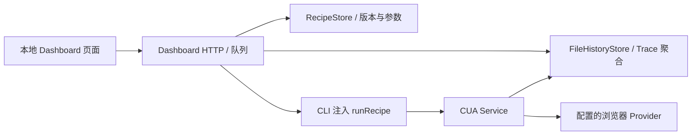

# 本地脚本执行中心

Dashboard 展示当前配置下的 Recipe、执行汇总、逐次 Trace 和截图，并提供参数化运行入口。独立于 Agent 宿主，Qoder、Codex、dsh 产生的历史使用同一套界面查看。

## 启动

仓库开发环境先运行 `bun install --frozen-lockfile`、`bun run build`，然后指定正在使用的安装配置：

```sh
bun run dashboard --config ~/.cua/installations/qoder/cua.json
```

也可以直接运行编译后的 CLI，完整运行包使用同样的命令：

```sh
node packages/cli/dist/index.js dashboard --config /absolute/path/cua.json --port 30152
```

访问终端输出的 `http://127.0.0.1:30152`。服务只监听 loopback；启动不会打开网页或浏览器，也不会执行脚本。Ctrl+C 停止服务。多个安装目录可分别用不同端口启动。

必须显式提供 `--config`，避免误读默认目录而漏掉某个宿主的记录。沿用配置的 `history.directory`、`recipes.directory`、`profiles` 和 `defaultProfile`，不复制记录或另建数据库。

## 页面

- **脚本列表**：搜索脚本，查看普通运行次数、通过率、当前激活版本。
- **脚本与校验**：按版本只读查看 `script`、`verify`、输入参数、前置条件、来源 run、父版本和 provenance。
- **版本记录**：各版本的验证记录与关联 Trace；可以查看旧版本，但运行按钮始终使用当前激活版本。
- **执行轨迹**：区分普通运行、版本验证、来源探索。执行单元与 SDK 调用组成瀑布图，点击查看输入、代码、输出、错误和操作阶段。阶段事件按 `callId` 合并到对应调用条中，原始事件完整保留并可搜索。旧记录缺 `callId` 时，只在同会话、同执行单元、同方法且完整时间区间唯一匹配时关联，并在详情中标注；并发歧义保留为单独的“底层操作”，不会仅凭名称去重。
- **运行结果**：显示已记录输出、参数、分析提示，以及正常截图和失败截图。商品列表输出可表格查看，完整 JSON 仍可展开。
- **运行脚本**：核对并编辑类型化参数，选择 Profile，提交后查看排队和实时 Trace。默认填入最近一次同版本参数或参数默认值。

## 执行与统计约定

普通执行复用 `runRecipe`，每次建立新会话，并执行该版本的 `verify`；不调用模型。页面不提供沉淀、修复、导入或激活操作，这些继续使用现有 CLI / Skill。若配置自动辅助但未提供模型，Runner 的既有 `model_required` 行为不变。

每个 Dashboard 进程串行执行任务；提交时固定版本，真正开始前再次检查激活版本，防止排队期间误跑另一个版本。同一次请求重复提交返回同一任务，不自动重试失败脚本。并发去重范围是当前进程保留的最近 200 个任务，最多允许 10 个排队或运行任务。跨 Dashboard 进程或 Agent 会话不共享执行队列。

队列只在进程内保存，关闭后不会自动重放；已经写入的执行历史持续保留。CLI 停止时取消待执行任务并关闭运行环境。历史记录关闭时按钮禁用，确保可追溯。

汇总仅计算**普通运行**，验证和探索不混入成功率；成功率分母为已结束普通运行，`verify` 通过计入通过。技术执行成功但没有业务确认显示“未确认”，缺结束事件显示“记录未结束”，不推断为仍在执行。只有当前进程的任务状态能够确认实时运行状态。验证通过表示已有断言通过，不替代业务结果复核。

“总时间”为首尾历史事件跨度，“执行耗时”为 CUA 执行单元耗时累计。未记录的 LLM 调用、成本、Token 不估算。没有模型规划树时，Trace 展示实际 CUA 调用层级。

## 架构与边界



`@cua/dashboard` 只依赖 history 和 recipes。浏览器 Runtime 由 CLI 首次执行时延迟初始化；页面启动及查看历史不会连接浏览器。Runner 接收预分配的 `runId`，使运行中的历史能够直接关联任务。

HTTP 使用每次启动生成的页面 token，校验 Host / Origin，不启用跨站访问。无任意代码执行 API，只能运行存储中已激活的脚本。附件必须来自可见历史事件的图片引用，并通过实际路径检查；私密会话的脱敏投影和附件移除继续由 History 执行。界面以文本呈现源码和网页输出。

## 功能验证

```sh
bun run build
node --experimental-vm-modules --import tsx --test tests/dashboard.test.ts tests/dashboard-ui.test.ts
```

测试覆盖真实 Runner 接 fake provider 的成功/校验失败与 runId 关联、参数和版本检查、防重复提交、串行队列、排队版本变化、HTTP 访问边界、截图路径与私密投影、阶段事件聚合，以及 happy-dom 中的页面导航、版本源码、Trace、截图和参数化提交。此命令不启动真实浏览器；视觉效果与真实业务网站运行需要单独验收。
