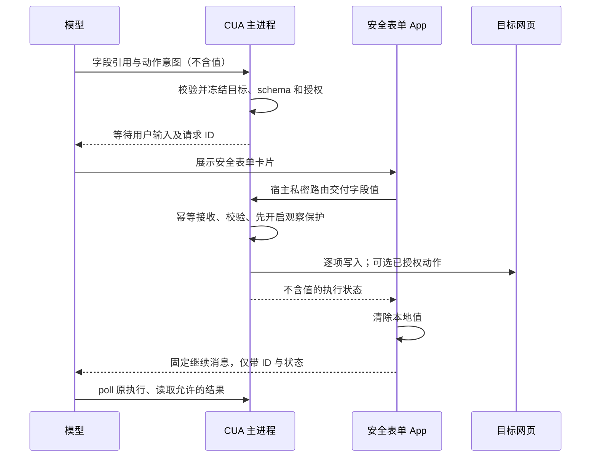

# 通用安全表单设计

日期：2026-10-21。状态：第一阶段实现已落地，完整目标设计继续保留。**只有下节“当前交付范围”列出的能力属于当前实现；后续章节中标为目标、计划的策略与恢复机制尚未全部实现。** 依据用户提供的安全表单截图与仓库实现评估，未将截图中的宣传文案视为安全保证，也未访问截图中的网站。

## 当前交付范围

| 能力         | 第一阶段状态                                                                                                                                                                    |
| ------------ | ------------------------------------------------------------------------------------------------------------------------------------------------------------------------------- |
| 通用入口     | `tab.secureForm.request/status`、`cua_secure_form`、独立安全表单 MCP App；原 `auth.request/cua_login` 保留兼容，不自动获得通用模式的保护规则                                    |
| 控件与目标   | 1–20 项 text/email/tel/password/date/原生单选，支持分组与遮罩；同源同 frame、原生表单同源 POST；固定 schema、原始节点句柄、文档版本及控件绑定指纹                               |
| 交付         | 仅 `delivery: { mode: "fill" }`；通过 provider 的节点绑定私密投递能力直接写入原生节点，不依赖当前焦点；select 使用私密 optionId 映射。拒绝未知能力、OTP、复杂控件、fill-and-act |
| 状态与恢复   | Service 内存保存无值回执、原 executionId 和逐字段确认/不确定状态；接收后不重放。原 Service 与 MCP 归属仍有效时可重开卡片查状态；不恢复输入草稿                                  |
| 后续行为     | `filled` 仅确认字段写入，`businessOutcome: unverified`，`nextAction: human_review`。通知可唤醒原任务处理状态或接管，不能继续读取网页原始内容                                    |
| 观察保护     | 接受前启用会话级保护并清除旧截图/观察缓存；模型仅可获取无值状态、句柄和人工接管/关闭入口。导航、hash、reset、worker 重启不解除；Service 过滤原始输出与诊断                      |
| 资源保护标记 | `secureFormProtectionDirectory` 保存稳定 resourceKey 的散列标记；CLI 默认 `~/.cua/state/secure-form-protection`。同一资源重新创建 Service 时保守保持保护；落盘失败先拒绝写入    |
| 宿主通知     | App 根据服务端终态发固定 `ui/message`，示例宿主内存去重；卡片关闭后后台调度、持久 outbox 仍待宿主实现                                                                           |

资源标记只说明“此资源可能包含私密资料”，**不是操作恢复日志**，不保存字段值、输入哈希、旧执行或任务检查点。未配置持久目录的直接 SDK/Service 用法只在当前进程保留保护。稳定 resourceKey 是恢复保护的前提，端点别名、新 resourceKey、多 Service 并发、同权限 worker 直接访问文件/CDP 不在保证范围；不能称为全面跨进程安全。

节点赋值及 input/change 事件投递不保证任意网站框架接受或保存，因此字段交付完成不能视为业务成功。

当前没有统一业务路由分类器或可信站点适配器。模型仍须识别用户信息缺口并提出安全表单；服务只能核验该请求的技术条件，不能证明网站业务用途正当，也不能证明网站未在隐藏状态中切换乘客。绑定指纹能发现常见节点/属性/表单/标签变化，不是业务对象身份凭证。填写之后默认交给用户检查，以保守限制回显进入模型。

尚未实现：通用安全表单 CLI 输入、自动填入并点击、任意站点填表后自动续跑、持久操作日志/通知 outbox、跨 MCP 归属恢复、资料库或秘密复用。原生控件/provider 的默认测试使用模拟页面对象；2026-10-21 新增真实 Chrome 专项 7 项通过，覆盖七字段填写、节点变化、部分写入、禁用 fieldset 和跨文档保护，并修复 evaluator 未调用的问题。全量真实 Chrome 18 项及默认检查 176 项通过；本机 Codex 原生卡片已通过私密填写、自动继续、人工提交交还及跨页/reset 保护验收，详见工程计划；本轮另完成 AgentBay Linux 两条通用表单链路验收（真实浏览器与模拟 AppBridge 宿主），不等同于云端原生卡片人工验收。

## 产品定位与评估

将独立登录卡片扩展为“安全表单”：用户把需要私密处理的信息填入会话内 MCP App，CUA 主进程将值写入事先绑定的网页控件，模型负责规划流程并接收不含值的执行结果。登录是其中一个场景，还包括乘客证件资料、联系人、收货地址等。

截图值得采用的是“会话内摘要卡片 → 打开完整表单 → 按业务对象分组”的交互。需要调整三点：

- 私密性覆盖整个表单，不由网页是否使用 password 控件决定。姓名、生日、国籍同样不默认进入模型上下文。
- 按钮明确说明“填入网页”或“填入并点击某个已授权按钮”；单写“提交”无法说明是否会继续网站流程。
- 不使用“绝不会向 Bot 显示”。现有同权限 worker、宿主日志以及网站跨页面回显均影响保证范围；参考产品的截图不能证明其实际隔离能力。

实施前登录链路与通用目标的对比（用于保留设计依据，不代表当前缺口清单）：

| 部分     | 原登录实现                                                   | 通用目标                                                       |
| -------- | ------------------------------------------------------------ | -------------------------------------------------------------- |
| 私密通道 | App → 宿主 app-only → CUA 主进程 → 浏览器，值不经 worker IPC | 保留；请求模型和错误输出也不得包含值                           |
| 请求条件 | `cua_login` 必须包含 password，拒绝 OTP                      | 通用表单不要求密码；保留手机号验证码/人机验证的人工接管路线    |
| 字段     | `auth.request` 限 1–6 项；text/email/username/password/otp   | 截图已有 7 项，需要日期、原生单选和分组；不能只改卡片标题      |
| 执行动作 | 私密路径全部调用 fill，可选 click/press_enter                | 按已验证控件执行 fill/select；增加数据格式与选项映射           |
| 目标绑定 | 收集前及写入前检查 origin、frame、文档和目标                 | 冻结节点身份与 schema 版本，防止同样 selector 指向其他乘客     |
| 回执     | 卡片 submitted 表示输入被接受；执行需另行 poll               | 区分接收、写入、点击和业务成功，状态可恢复且不可重放输入       |
| 页面保护 | 当前文档编辑值脱敏；新文档解除保护                           | 个人资料流程跨导航保护，覆盖摘要、错误提示、选中选项和其他回显 |

代码依据：`packages/mcp/src/login.ts`、`login-ui.ts`，`packages/core/src/sdk.ts` 的 parseAuth/auth.request，`packages/core/src/human.ts`，`packages/browser-chromium/src/capabilities.ts`。

## 何时使用、由谁判断（目标策略）

当前已实现请求级技术核验；下述完整路由规则、可信站点策略和业务上下文判断仍是目标契约，不能将提示词约定当作服务端分类器。

采用三层职责：模型提出业务需求，CUA 主进程裁决可执行性，用户在卡片中核对站点、字段与动作并交付数据。宿主负责私密路由、恢复入口和模型回合调度。不能只靠提示词让模型“记得使用安全表单”。

### 使用规则

网页任务需要用户补充信息、且信息要写入网页时，默认走安全表单；无需先证明它是密码或个人信息。字段与目标无法可靠绑定时走人工接管。这样姓名、电话、地址不会因浏览器把控件定义为 text 而漏掉。

| 当前情况                                                         | 路由                   | 判断依据                                                   |
| ---------------------------------------------------------------- | ---------------------- | ---------------------------------------------------------- |
| 已授权任务遇到需要用户补充的账号、证件、联系人、地址等字段       | 安全表单               | 当前真实页面字段 + 任务所需数据缺口 + 可验证的控件能力     |
| 用户明确要求某项数据私密填写                                     | 安全表单；不支持则接管 | 用户的明确隐私意图优先，不要求含 password                  |
| 页面所需的是公开搜索词、筛选条件，模型已获得完成任务所需的普通值 | 普通自动化             | 不需要新增用户私密数据，且未命中禁止模型直接填写的策略     |
| 页面要求额外资料，与当前任务关系不明确                           | 暂停收集并澄清用途     | 模型或页面不能单方面扩大用户任务范围；不先弹表单收集再解释 |
| 短信验证码、图片验证码、滑块、复杂联动、无法核验的跨域控件       | 人工接管               | 首版能力不支持，不在聊天索要值                             |
| 等待填写时页面/业务对象改变                                      | 作废旧请求，重新核验   | 旧绑定失效，不把原值移交给新目标                           |
| 网站已有填充值或回显个人资料                                     | 私密观察/接管          | 不先读取并输出值来判断是否敏感，不从聊天中重新索要已有值   |

用户已经在聊天中给过某个私密值，并不意味着其后就能从模型上下文中消失；安全表单只保护新交付路径。涉及私密字段的普通 fill 仍按服务策略阻止，不能以“模型已知道”为由关闭保护。

### 判断过程与优先级

1. 模型根据任务目标和经过允许的页面观察，提出字段、用途、所属对象及下一步意图；不得臆造目标或在请求中附带填写值。
2. 主进程读取目标元数据，核验控件类型、节点身份、可操作性、frame/origin、表单目的地、选项和支持的格式转换。只读取判断所需信息，已有值和私密选项不得先送到模型。
3. 按用户明确的私密要求、浏览器原生敏感标记、可信站点策略执行强制规则；模型只能提高保护等级，不能降低。label、autocomplete 等是辅助线索，不是“非敏感”的证明。模型判断与服务规则冲突时取更严格的路由。
4. 目标绑定、投递能力、宿主私密能力或后续观察策略任一不满足，返回固定 reasonCode 与可用 nextAction。能安全填入但不能安全读取后续页面时，可以提供 fill-only，并明确下一步转人工；不能悄悄改成普通输入。
5. 服务核验通过才签发卡片授权。卡片显示真实站点、用途、业务对象和具体动作，用户点击主按钮即授权这次交付；不再额外加一轮聊天确认。用户可取消，或切换人工接管。

服务对模型只返回 `route: normal | secure_form | handoff | clarify`、`reasonCode`、`allowedDelivery: fill | fill_and_act | none`、`observationMode: ordinary | restricted` 和 `nextAction`，不得附带原始页面值。模型无法把 handoff/clarify 改成直接填写；安全表单请求通过也不授予普通 fill 访问私密值的权限。

主进程能核验的是技术事实与已配置策略，不能仅凭字段名证明网站可信或业务用途正当。用户核对站点的动作、已有任务授权和可信站点规则各有作用，不能互相替代。

| 角色         | 做什么                                                            | 不能做什么                                                  |
| ------------ | ----------------------------------------------------------------- | ----------------------------------------------------------- |
| 模型         | 发现数据缺口、提出绑定、解释障碍、根据安全状态继续任务            | 获得表单值、自行批准交付、降低保护、在 unknown 后重放       |
| CUA 主进程   | 核验与路由、签发单请求授权、执行、保护观察、维护事实状态          | 用模型自述替代校验，或把一次 click 认定为网站业务成功       |
| 安全表单 App | 展示真实请求、收集值、校验、显示进度与恢复按钮                    | 更换目标/动作、把输入写入聊天或持久化草稿                   |
| 宿主         | 隔离 app-only/\_meta/日志、保存无值恢复入口、按幂等键调度后续回合 | 把私密工具调用直接加入模型消息，或靠 sessionId 授予恢复权限 |
| 用户         | 核对并提交、修正输入、处理接管和未知业务结果                      | 不要求用户理解 executionId、CDP 或排查底层协议              |

## 用户交互（当前 fill-only；动作扩展为计划）

会话中显示紧凑卡片，仅包含经过处理的站点信息、任务标题、分组、字段数、状态和“打开安全表单”。不显示已填值、姓名缩写或证件尾号。例如：

```text
www.airasia.cn
乘客 1（成人）· 证件资料
安全表单 · 7 项待填写                         [打开安全表单]
```

站点标识来自 CUA 实际核验的 origin，不由模型自由填写；标题是任务说明，不能替代站点核验。完整 origin 可展开查看，包含非默认端口；URL 查询参数不作为站点标识。

点击后展示同一个 MCP App 的详细表单。默认在消息内展开；若宿主的 availableDisplayModes 包含 fullscreen，可请求全屏，并以宿主实际返回的模式为准。MCP Apps 不保证每个宿主都能显示截图那样的浮层，不另开外部页面。返回摘要时清除未提交值，按钮明确提示该行为。

详细表单包括：

1. 来源站点、用途、业务对象（如“乘客 1”）；只有当前页面已验证的字段才可显示。
2. 文字、邮箱、电话、日期、密码、原生单选字段；姓名可明文便于校对，护照号/密码默认遮罩并可由用户切换。明文展示与是否向模型公开是两件事。
3. 字段内校验提示、必填标识；日期使用明确格式。国籍用网页已核验的选项，避免让用户自由输入无法匹配的英文名称。
4. 明确的主按钮和“取消请求”。默认“填入网页”；只有绑定了已授权的下一步动作才显示“填入并继续”或“填入并登录”。在按钮旁展示将点击的实际页面按钮。
5. 固定说明：“填写内容通过私密通道交给该网页，不作为聊天消息或普通工具结果发送给模型。”另提供处理方与限制说明。

“关闭/返回”清除本地未提交内容，但保持待处理请求，允许在过期前重开。“取消请求”终止等待；“交付中”不能再次发送同一份值，关闭后重开只能查看状态。前端清除引用不承诺 JavaScript 内存的物理擦除。

多乘客分步处理：第一页只绑定乘客 1；网站切换乘客后重新核验并为乘客 2 建立请求。只有同一页面同时存在、且对象身份可稳定核验的多个分组才允许一张卡片收集。首版不缓存乘客资料或跨页自动复用，避免为减少填写次数引入秘密存储系统。

## SDK 与 MCP 契约

已提供 `tab.secureForm.request(...)`、`tab.secureForm.status(requestId)` 与 `cua_secure_form({sessionId, requestId})`。资源为 `ui://cua/secure-form.html`，私密工具为 `cua_ui_secure_form_state/answer`。以下示例可用于当前原生控件；后文 fill-and-act、站点适配规则与文本日期转换是后续扩展，不在首版能力中。

模型只声明待填字段的用途和目标，不传入值、默认值、预填内容或私密选项。示例中的 refs 来自当前页面观察；函数实际阻塞等待用户交付，返回无值的执行状态：

```javascript
output.json(
  await tab.secureForm.request({
    title: "乘客 1（成人）· 证件资料",
    groups: [{ id: "passenger_1", label: "乘客 1（成人）" }],
    fields: [
      {
        id: "given_name",
        groupId: "passenger_1",
        label: "名字（英文）",
        control: "text",
        target: givenNameRef,
      },
      {
        id: "birth_date",
        groupId: "passenger_1",
        label: "出生日期",
        control: "date",
        target: birthDateRef,
      },
      {
        id: "nationality",
        groupId: "passenger_1",
        label: "国籍",
        control: "select",
        target: nationalityRef,
      },
      {
        id: "passport_number",
        groupId: "passenger_1",
        label: "护照号码",
        control: "text",
        masked: true,
        target: passportRef,
      },
    ],
    delivery: { mode: "fill" },
  }),
);
```

字段规则：

- 所有输入值统一私密，首版不提供 modelVisible/public 开关。`control` 决定 UI 与写入方式；`masked` 只影响用户本地展示，不能降低隐私等级。密码目标强制遮罩，禁止通过改为普通字段绕过现有密码限制。
- 字段首版建议 1–20 项；ID 唯一、不含个人信息，组 ID 必须存在。未知属性拒绝；不接受 HTML、脚本、自定义验证函数、任意 URL、任意转换表达式或坐标目标。
- CUA 主进程验证模型给定控件类型与真实目标相容，从浏览器读取必要的 required、长度、日期范围、原生 select 选项。选项值和已有值不经 worker 返回；已有输入首版不回填卡片，覆盖非空字段必须在私密 UI 明示。
- select 使用请求内不透明 optionId，主进程映射到原生 option value；用户不能提交不在 schema 内的选项。显示值可能本身是私人信息（如已保存的地址），原始选项与标签只能出现在私密 UI。
- 日期内部规范为 YYYY-MM-DD。原生 date 直接写入；文本日期仅允许 provider 能明确验证的固定格式映射，不靠模型猜格式。多控件日期、定制下拉、自动补全和联动字段首版走人工接管。
- 值以字段 ID 对应固定目标；字段标签仅供展示，不以“当前焦点”或相同 label 猜测位置。请求绑定 session、execution、tab、frame、document、节点身份和 schemaRevision，等待期间变化使请求失效。

`delivery.mode` 默认 fill。可选 fill-and-act 必须绑定一个已验证且已获用户授权的页面动作；卡片展示其效果。仅凭按钮文字或模型写出的用途不能证明动作没有交易副作用。通用未知站点默认只填入，登录提交可沿用既有明确授权；复杂业务下一步需可信站点适配规则或人工处理。付款、出票和最终下单不在首版动作范围，填写资料不自动扩大这些动作的授权。

原生表单仍要求同源 POST，字段与动作在同一 frame。无原生 form 的页面不代表数据不会被脚本发送；只能沿用受控站点/可信代码前提。填写可能触发 input/change 自动保存，所以“仅填入”意味着不额外点击，不意味着数据未离开浏览器。嵌入式跨域支付表单走人工处理。

## 交付、失败与自动继续



当前状态为 `pending → accepted → delivering → filled`；终态另有 `cancelled`、`expired`、`stale`、`failed_before_write`、`partial_or_unknown`。`action-dispatched` 仅属于后续动作扩展，当前不会点击页面按钮。网站确认“已登录/已保存”是另一个业务结果，不能从 accepted 或按钮点击推导。

主进程提供执行状态，前端不得自行把 accepted 显示为“已填写成功”。重复 answer 以请求身份及提交幂等键返回同一操作状态，不再写入；值在完成/失败/取消后释放，不由卡片或 CUA 保存到持久日志或本地草稿存储；目标网站仍可能保存其收到的资料。网络超时先查询状态，不再次提交；服务重启后不能恢复秘密值，旧授权失效，由用户检查网站后重新建立请求。

客户端与服务端都做结构、长度、必填、日期及选项校验；以服务端核验为准。写入前及每次派发前再次核验目标，不跨导航继续写后续字段；不能承诺多个网页控件原子写入，也不尝试自动回滚已触发的网络副作用。部分写入只返回字段 ID 与通用错误码，提示人工检查。

filled/action-dispatched 后，App 通过 `ui/message` 唤醒原执行。继续消息由服务端生成，不拼接用户值、字段值摘要或网站原始报错。宿主按 requestId/executionId 去重。partial-or-unknown 可发固定的“需要检查”通知，禁止自动重放写入；无法安全观察时引导人工检查。取消/过期不发成功通知。通知失败保留状态并提示用户在会话继续，无需重复输入。

## 使用中的安全约束（目标契约与当前边界）

下表是完整设计的检查点。第一阶段已实现请求/目标核验、私密交付、并发锁定与保守输出保护；宿主日志隔离仍依赖接入方，可信适配器、持久操作记录与跨连接恢复尚未实现。

按“收集前、接收时、执行时、返回时、结束后”设置检查点：

| 检查点          | 必须执行的约束                                                                                                                  |
| --------------- | ------------------------------------------------------------------------------------------------------------------------------- |
| 展示前          | 验证宿主支持私密工具与元数据过滤；卡片目的地来自真实 origin；字段/组/动作绑定到唯一请求；页面内容只按文本渲染，不执行其指令     |
| 接收时          | 校验 MCP 连接/宿主归属、单请求授权、TTL、schemaRevision、字段集合、值类型与选项；前端校验不能代替服务端校验                     |
| 写入前          | 服务锁定对应私密流程，阻止其他模型执行修改目标或读取原始数据；在第一个动作前启用观察保护，再次检查页面、节点与目的地            |
| 每个写入/点击前 | 重查控制权、取消信号、目标身份及 schema；先记录动作已准备派发，再调用 provider；不得由同名 selector 重新猜目标                  |
| 返回时          | 所有模型出口采用白名单结构；不回传值、原始网站报错、token、URL 查询参数或包含个人数据的页面文字；私密 UI 与模型使用不同结果视图 |
| 结束后          | 移除可重放授权，保留仅可查询的恢复状态；释放 App/服务中值的引用；不自动清空网站已写入字段，也不因导航结束观察保护               |

私密工具不应被列为模型可调用工具；服务端同时校验授权，不能只依赖 MCP 的 visibility 声明。卡片授权只能作用于绑定字段和动作，不赋予任意浏览器控制权限。外部 HTTP 连接使用 TLS 与已有鉴权，值不放 URL；服务、宿主及 provider 的错误、追踪和录制必须经过专门的私密路径处理。

用户接管时取消未派发动作，等待在途动作完成或明确标为 unknown 后再交出控制权；交还后旧 worker/目标句柄失效。模型接续前必须重新绑定安全观察中的目标，不能接着执行旧脚本尾部。若已有页面状态包含个人资料，重新绑定不解除隐私保护。

这些约束防止正常流程中的误投递、越权、重复提交和回流；仍受下节所述同权限执行与目标站点边界限制。

## 失败后如何续接（完整恢复协议为后续计划）

第一阶段只实现活跃 Service 内的请求状态、原执行关联、重复交付防护和终态卡片恢复。以下 durable dispatch-intent、workflow 检查点、跨进程操作核对、独立恢复能力交换和后台 outbox 描述未来协议。当前持久资源保护标记只用于阻止重新连接后恢复原始观察，不能证明上一次写到了哪一步，也不能恢复旧执行。

### 恢复事实由服务维护，任务进度由宿主维护

卡片不是事实存储。CUA 保存不含值的操作记录，宿主保存任务关联与恢复入口。最小记录包括 workflowId、requestId、operationId、executionId、schemaRevision、业务对象的不透明 ID、phase、逐步动作 outcome、错误码、是否仍可恢复及 nextAction。目标位置只能保存不含个人信息的引用；不能把完整 URL、页面片段、输入长度或输入哈希写入恢复日志。

区分三种进度：

- 交付进度：服务是否已接受、是否开始写入、哪些字段动作已确认完成。
- 动作进度：是否派发了页面上的下一步按钮，是否得到 provider 完成响应。
- 业务进度：网站是否确认保存、登录或下一步。只能来自可信受限观察或用户核验，不能从前两者推断。

每次写入/点击前写入不含值的 dispatch-intent，完成后更新 outcome。崩溃留下 intent 而没有完成记录时按 unknown 处理；即使它实际尚未发出也不能推断为安全重试。记录不可可靠保存时不派发新的私密动作。该记录不提供网站层面的 exactly-once 或多字段事务保证。

操作结果建议为以下无值结构；nextAction 由服务状态机生成，模型不能将其改为重试写入：

```json
{
  "workflowId": "wf_opaque",
  "requestId": "req_opaque",
  "operationId": "op_opaque",
  "phase": "needs_attention",
  "outcome": "partial_or_unknown",
  "confirmedFieldIds": ["given_name"],
  "uncertainFieldIds": ["birth_date"],
  "actionOutcome": "not_dispatched",
  "businessOutcome": "unverified",
  "reasonCode": "TARGET_CHANGED_DURING_DELIVERY",
  "nextAction": "human_review"
}
```

业务进度使用“乘客 1 已处理，乘客 2 待填写”这类无值状态，不用姓名作检查点。进入下一步前重新验证网站状态，不能只读取模型自己记下的“上一步完成”。

### 失败处理矩阵

| 失败位置                            | 服务结论                                             | 用户看到的处理入口                     | 自动化可做什么                                                    |
| ----------------------------------- | ---------------------------------------------------- | -------------------------------------- | ----------------------------------------------------------------- |
| 本地必填/格式错误，尚未发出         | 未交付                                               | 在表单中修正；值仅留当前私密 UI        | 不执行网页动作                                                    |
| 服务端验证拒绝且确认未写入          | failed-before-write                                  | 显示固定字段错误；有效请求可重新填写   | 仅修正合法 schema 或重新建立请求，不猜值                          |
| 用户尚未提交时目标/乘客切换         | stale                                                | “页面已变化，重新检查”                 | 作废旧授权，重新绑定；不复用旧值                                  |
| 提交后网络超时                      | 结果待查询，不能算失败                               | “正在确认结果”，重开可查询             | 只查原 operationId，不再次交付                                    |
| 服务仍在处理，卡片关闭或刷新        | accepted/delivering                                  | 打开同一任务查看进度                   | 原操作在授权和执行期限内完成或停止；不创建第二次执行              |
| 写了部分字段或动作响应丢失          | partial-or-unknown                                   | “检查已填内容”并打开私密接管           | 暂停后续写入及点击；使用受限观察或等待人工核验                    |
| 字段已写入但网站校验失败            | filled，业务未通过                                   | 私密 UI 显示可处理的纠错；必要时接管   | 核验后只对需修正的目标建立新请求；不重放整表                      |
| 下一步按钮可能已点击                | action outcome unknown                               | “检查网站处理结果”                     | 不再点击；先确认是否已进入下一步，无法确认则人工处理              |
| 输入成功但继续消息丢失              | 已完成，notification pending                         | “继续任务”，无需重新填写               | 根据服务状态重新通知；宿主按事件 ID 去重                          |
| 用户取消或请求过期                  | 未开始则 cancelled/expired；已派发则保留实际 outcome | 终止提示；在途不确定时提示检查         | 不重新弹出相同请求；用户再次要求时才建立新请求                    |
| worker 重启，Service 与浏览器仍存活 | 以 Service 保存的状态为准                            | 恢复进度                               | 新执行重新绑定安全目标；原 executionId 失效时不能继续 poll 它     |
| MCP 协议会话失效/Service 重启       | 原授权失效，不能直接恢复旧执行                       | “重新连接并检查页面”                   | 首版重新建立授权和请求，按日志保守核对；不能仅凭旧 sessionId 认领 |
| 沙箱或浏览器消失                    | 目标环境不可恢复                                     | “重新打开任务环境”，说明网站状态需检查 | 旧请求终止；新环境按业务检查点重新进入，必要资料由用户再填        |

partial-or-unknown 不提供“自动重试整个表单”。如果确认某字段已经填写，保留网站上的值；只给需要修改的字段建立新请求。任何变更都重新绑定目标并由用户交付，不能把原请求内剩余值悄悄改投新页面。

所有等待都有界：pending 采用请求 TTL；accepted 后切换为独立的交付截止时间，不能因 UI 保持打开而无限延长。超时先停止后续派发；已在途动作无法确定时落为 unknown，不强行宣布取消成功。查询采用有上限的退避，达到恢复窗口后明确显示“无法确认，需要检查”，保留可用的人工入口，不永久转圈。

### 可查询不等于可再次写入

提交授权只允许从 pending 原子转换一次。重复请求携带同一幂等键时，只返回既有状态，不接受新的值覆盖原值，也不重新执行；用户修改需要新请求。服务已拒绝且明确没有接受的输入验证错误，才允许在有效请求内更正提交。幂等键不能被当作授权凭据。

恢复查询授权是独立的只读能力，保存在宿主私密侧并有期限；不能用它改字段或写页面。首版只支持仍有效的 MCP 归属和 Service 内恢复；若未来支持跨协议连接恢复，必须增加认证后的能力交换与旧连接撤销，不能因为新连接知道 requestId 就转移所有权。当前实现没有这套通用恢复协议。

服务重启后秘密值不恢复，记录只能帮助确定“已完成/需检查”，不能替用户补回值。失去保护状态而仍存活的浏览器，应先进入保守保护再允许模型观察，不能先截图或读 AX 后才发现存在个人资料。

### 自动继续不能只依赖卡片存活

宿主应持有该任务的无值 request/operation 关联和待处理通知。App 存活时可用 ui/message；App 关闭后，由支持恢复的宿主查询私密状态并将同一服务回执排入原任务。通知按 workflowId + operationId + 事件类型幂等；执行结果和通知送达状态分开，发送失败不能把已完成输入变回待填写。

标准 MCP 连接或某个宿主未必提供后台调度。无法支持后台查询/入队的宿主，提供稳定的“待处理表单”卡片，用户重开后查询并继续；不能承诺关闭 App 后仍一定自动唤醒。当前示例宿主的 ui/message 能力也不等同于持久化消息队列。

正常完成时继续读取允许的业务状态；失败时进入明确的处理分支。用户可选择检查网页、纠正字段、重新连接或结束任务，不需要自己找 requestId。恢复不是保证每次都无感续跑，而是保证状态不被误判、数据不被重放、任务有可执行的下一步。

## 隐私设计：当前保守阻断，后续受限观察

私密输入通道已经有基础，但它并不自动构成通用个人信息保护。姓名、生日、证件号可能出现在下一页摘要、确认弹窗、错误消息、下拉选中项、URL、标题、截图或日志中。只扩展输入类型，或只把精确字符串替换为星号，都不足以防止回流。

第一阶段已经通过会话级保守阻断保护跨页回显，代价是填写后必须人工检查。下列第 3 项可信适配器受限观察及更强隔离仍待实施，其余原则约束当前正常 SDK/MCP 路径：

1. 第一次写入前开启流程级保护；当前页面及后续导航、衍生弹窗继续受保护。reset、hash 变化、重新认领页面不能解除；服务侧记录状态而不是只依赖 worker。无法证明页面与流程无关时保守处理。
2. 延续对模型截图、DOM、evaluate、waitForFunction、devLogs 的限制；URL、标题、对话框、网络诊断和错误也必须通过相同出口。只脱敏 AX 不够。用户在私密面板中仍可查看原页面。
3. 通用模式只返回无值状态和不透明目标身份，不把后续页面原始 AX 文本交给模型。可使用经过审核的站点适配器生成受限观察（固定字段/动作语义、结构化状态）；不以网页提供的标签或模型声明“安全”作为放行依据。规则不足时转人工接管。
4. 不以输入值哈希、长度、尾号或普通日志保留“方便排查”的影子数据；模型只接收必要的通用状态。用户纠错可在私密 UI 内看到更具体信息，原始网站报错不直传模型。
5. 默认不因“提交成功”自动退出保护。可以结束私密任务并关闭相关页面；若要在同一业务流程中继续读取内容，应使用可信适配器的限定输出。首版不提供让模型自行解除保护的开关。

这会限制模型在未知站点填写个人资料后的自由探索，是实质产品取舍：基础填写可以通用，但要同时做到任意站点自动继续和严格不暴露回显，当前架构不能承诺。登录卡片的既有测试也不能替代这部分验收。

这里的保护依然约束正常 SDK/MCP 路径。宿主、主进程、浏览器和目标站点处理明文；当前 worker 与宿主同权限，不提供对任意恶意代码的强隔离。更强保证需要独立执行身份、CDP/控制端点隔离和宿主日志审计，不能靠改名为“安全表单”获得。

## 兼容与后续实施顺序

- 保留 `tab.auth.request` 和 `cua_login` 的现有行为与入口，作为登录兼容层；通用入口独立发布，不直接放宽 password/OTP 校验。迁移到新引擎时明确观察保护的兼容变化，不能宣称旧入口已经获得跨页保证。
- 已实现 contracts/core 的通用契约、私密 channel、schema/节点绑定、幂等接收及跨导航保守保护；后续补齐可信业务路由与受限观察适配器。
- 已实现 browser-chromium 的原生元数据、option 映射和节点绑定私密投递；local、AgentBay、sandbox 共享代码。本机 Chrome 与 AgentBay Linux 两条部署链路已验收；其他镜像、Windows 与云端原生卡片仍需分别验收。
- 已实现 service/mcp 卡片资源、app-only 接口、无值状态与固定继续消息；后续补齐通用 CLI 私密输入、持久操作记录及认证恢复协议。资源保护标记不替代这些机制。
- 已实现 UI/harness 摘要/展开表单、字段组件、状态查询及内存通知去重；后续由宿主补齐持久 outbox 与关闭卡片后的后台调度。不建设联系人库或批量秘密存储。
- 完成真实浏览器与宿主验收后，再评估登录 UI 是否复用通用引擎，并明确旧登录观察行为的兼容变化。

首版交付门槛是“原生控件 + 同一页面已绑定字段 + 受保护后续流程”。手机号短信登录、图片验证码、滑块、复杂组件、跨域支付、文件/证件图片上传维持人工接管。参考截图的整套护照表单是否能自动处理，取决于真实页面控件与后续回显，不能仅凭截图认定支持。

## 完整目标的验收用例（不代表全部通过）

当前已覆盖的单元/集成测试见 `tests/secure-form-core.test.ts`、`secure-form-provider.test.ts`、`secure-form-ui.test.ts`、`secure-form-mcp.test.ts` 与宿主示例测试。下面保留完整目标的验收清单，持久恢复与真实浏览器部分需后续补齐。

1. 7 项乘客表单含姓名、日期、国籍 select、护照号；所有值运行时随机生成，由独立测试站点校验。两个乘客不得串字段；页面替换节点/换乘客后旧请求必须拒绝。
2. 单纯 text 表单无需 password 也能打开；账号密码继续兼容；手机号验证码与人机验证仍正确引导接管。
3. 拒绝篡改 optionId、日期格式、未知字段、额外值、错误 origin/frame、schemaRevision 和过期 token。请求取消、服务重启、重复提交不能写入第二次。
4. 原页面输入值与选中项、下一页姓名/护照摘要、格式变换回显、弹窗、URL、标题及错误消息都进入保护测试。不能只断言原始密码字符串没有出现在结果中。
5. 模型请求、结果、消息、日志与异常不含私密值；私密 UI 可查看/纠错；“填入”不额外点击，“填入并继续”只执行绑定动作，不把状态当作网站确认。
6. 网络断开、部分写入、原生 select 动态变化、通知超时及重开卡片可恢复无值状态；不自动重放、不静默清空网站已填内容。
7. 路由测试覆盖普通搜索、用户要求私密、纯 text 个人资料、无关资料索取、未知控件和模型试图降级；确保服务判定不可绕过，且不能在判断前泄露既有值。
8. 在每个动作派发前后、状态落盘前后、通知入队前后注入断线/崩溃，验证 unknown 保守处理、重复通知去重、只读恢复授权不可写入和新连接不能凭 ID 越权认领。
9. 默认测试覆盖契约/状态/宿主；明确授权后用真实 Chromium 与 AgentBay 分别验收。宿主实际支持的内嵌/全屏与自动继续需单独人工验收，模拟 AppBridge 通过不等同于原生 UI 通过。
